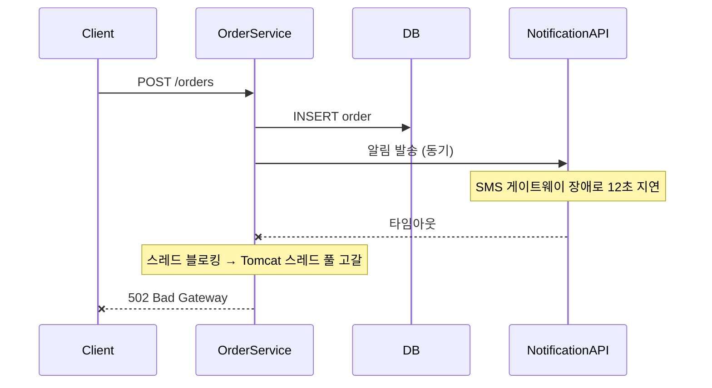

# #0-1. 전염

## 흐름도



## 스토리

월요일 오후 2시. 주문 서비스는 평화로웠다.

주문이 들어오면 DB에 저장하고, 알림 서비스 API를 동기로 호출해서 고객에게 알림을 보내는 구조였다. 단순하고 명확했다.

```java
@Transactional
public Order createOrder(String itemName, int quantity, int totalPrice) {
    Order order = orderRepository.save(new Order(itemName, quantity, totalPrice));
    notificationClient.sendOrderConfirmation(order.getId());  // 동기 HTTP 호출
    return order;
}
```

오후 2시 12분. 알림 서비스가 느려지기 시작했다. 알림 서비스가 사용하는 외부 SMS 게이트웨이에 장애가 난 것이다. 평소 100ms이던 응답이 8초, 12초, 타임아웃.

주문 서비스의 `createOrder()`는 `notificationClient.sendOrderConfirmation()`에서 멈춰있었다. 응답이 올 때까지 스레드가 블로킹됐다. 1개, 2개, 5개, 10개. Tomcat 스레드 풀이 고갈되기 시작했다.

오후 2시 15분. 주문 API의 응답 시간이 100ms → 12초로 뛰었다. 프론트엔드에서 타임아웃 에러가 뜨기 시작했다. 고객들이 주문 버튼을 다시 눌렀다. 요청이 더 쌓였다. 스레드가 더 막혔다.

오후 2시 18분. 주문 서비스 헬스체크 실패. 로드밸런서가 인스턴스를 빼기 시작했다.

**알림 서비스의 장애가 아니었다. SMS 게이트웨이의 장애였다.** 그런데 주문 서비스가 죽었다. 주문과 알림은 아무 관련이 없는데, 동기 호출 하나가 장애를 전염시킨 것이다.

## 교훈

- 동기 호출은 호출 대상의 장애를 호출자에게 전염시킨다.
- 알림 발송이 실패했다고 주문까지 실패할 이유는 없다. 주문과 알림은 결합되어서는 안 되는 서로 다른 관심사다.
- 핵심 로직(주문 저장)과 부가 로직(알림 발송)은 분리해야 한다.

## 더 생각해보기

- 동기 호출이 무조건 나쁜 걸까? 결제 API처럼 "결과를 즉시 알아야 하는" 호출도 비동기로 바꿔야 할까?
- 동기 호출을 유지하면서 장애 전파를 막는 방법은 없을까? (힌트: Circuit Breaker, Timeout, Bulkhead)
- 비동기로 바꾸면 고객에게 "주문 완료"를 언제 보여줄 수 있을까? 알림 발송이 끝나야 완료인가, 주문 저장만 되면 완료인가?

## 재현

```bash
./gradlew test --tests "S00_1_ContagionTest"
```
