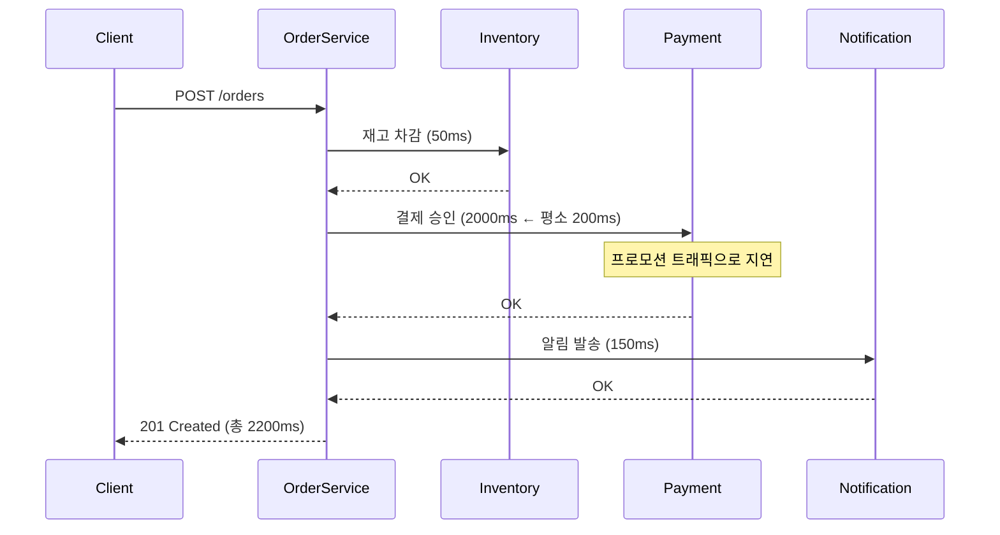

# #0-2. 느린 동반자

## 흐름도



## 스토리

수요일 오전 10시. 프로모션 시작.

주문 생성 시 세 곳에 동기 호출을 하는 구조였다.

```java
@Transactional
public Order createOrder(String itemName, int quantity, int totalPrice) {
    Order order = orderRepository.save(new Order(itemName, quantity, totalPrice));
    inventoryClient.decreaseStock(order.getId());       // 재고 서비스 (50ms)
    paymentClient.processPayment(order.getId());        // 결제 서비스 (200ms)
    notificationClient.sendOrderConfirmation(order.getId());  // 알림 서비스 (150ms)
    return order;
}
```

평소 총 응답 시간: 50 + 200 + 150 = **400ms**. 나쁘지 않았다.

프로모션이 시작되자 결제 서비스에 트래픽이 몰렸다. 200ms이던 응답이 2초로 느려졌다. 주문 API 전체 응답 시간: 50 + 2000 + 150 = **2,200ms**.

재고 서비스와 알림 서비스는 멀쩡했다. 그런데 주문 API는 2.2초짜리가 됐다. 결제 서비스 하나가 느려졌을 뿐인데, **주문 전체가 느려진 것**이다.

고객 화면에서는 주문 버튼을 누르고 2초 넘게 빙글빙글 로딩이 돌았다. 이탈율이 올라갔다. 마케팅팀이 슬랙에 올렸다.

> "프로모션 시작했는데 주문 전환율이 어제 대비 40% 떨어졌어요."

세 서비스 중 가장 느린 서비스가 전체 응답 시간을 결정하는 구조. 동기 호출을 직렬로 엮으면, **가장 느린 동반자의 속도에 맞춰야 한다**.

## 교훈

- 동기 직렬 호출의 총 응답 시간 = 각 호출 시간의 합. 하나가 느려지면 전체가 느려진다.
- 결제 처리가 끝나야 알림을 보낼 수 있는 것은 아니다. 순서 의존성이 없는 호출은 비동기로 분리할 수 있다.
- "주문 저장"만 동기로 처리하고, 나머지는 이벤트로 발행하면 주문 API 응답 시간을 DB INSERT 시간만으로 줄일 수 있다.

## 더 생각해보기

- 세 서비스를 직렬이 아니라 병렬로 호출하면 문제가 해결될까? CompletableFuture.allOf()로 동시에 호출하면 총 응답 시간은 "합"이 아니라 "최댓값"이 된다. 그러면 병렬 호출의 단점은 뭘까?
- 응답 시간이 느려지는 것과 아예 실패하는 것은 다른 문제다. 느린 건 기다리면 되지만, 어디까지 기다려야 할까? 타임아웃을 3초로 잡으면 정상 요청도 잘릴 수 있고, 30초로 잡으면 스레드가 고갈될 수 있다.
- 주문 API 응답 시간에 알림 발송 시간이 포함되어야 할까? 고객 입장에서 "주문 완료"의 의미는 뭘까?

## 재현

```bash
./gradlew test --tests "S00_2_SlowCompanionTest"
```
