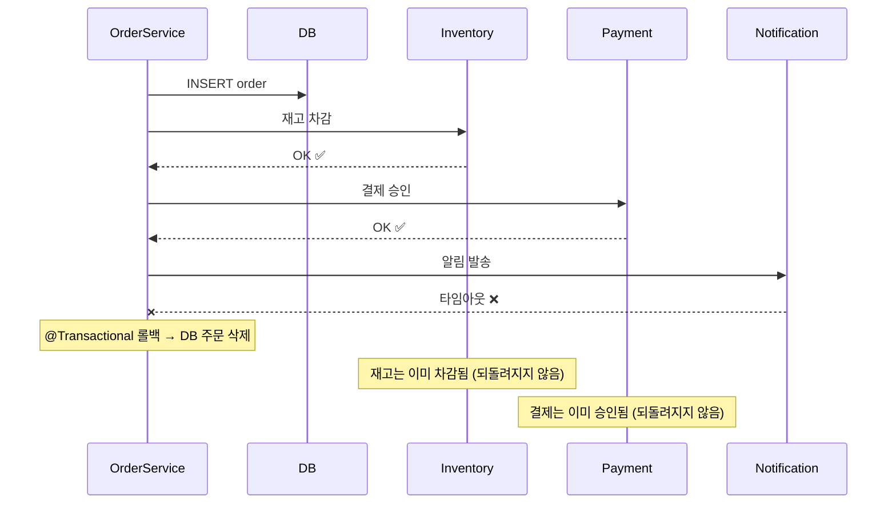

# #0-3. 부분 성공

## 흐름도



## 스토리

금요일 오후 5시. 퇴근 직전.

```java
@Transactional
public Order createOrder(String itemName, int quantity, int totalPrice) {
    Order order = orderRepository.save(new Order(itemName, quantity, totalPrice));
    inventoryClient.decreaseStock(order.getId());           // ✅ 성공 — 재고 차감됨
    paymentClient.processPayment(order.getId());            // ✅ 성공 — 결제 승인됨
    notificationClient.sendOrderConfirmation(order.getId()); // ❌ 실패 — 타임아웃
    return order;
}
```

알림 서비스 호출에서 예외가 터졌다. `@Transactional`이 걸려있었으므로 DB의 주문은 롤백됐다.

그런데 재고 차감과 결제 승인은? 외부 API 호출이었다. **DB 트랜잭션 롤백이 외부 시스템의 상태를 되돌려주지 않는다.**

결과:
- DB: 주문 없음 (롤백됨)
- 재고 서비스: 재고 1개 차감됨 (되돌려지지 않음)
- 결제 서비스: 결제 승인됨 (되돌려지지 않음)
- 알림 서비스: 발송 안 됨

고객은 "주문 실패" 메시지를 받았다. 그런데 카드에서 돈은 빠져나갔다. 재고는 줄어들었다. 주문 기록은 없다.

월요일 아침. CS팀에 전화가 쏟아졌다.

> "결제는 됐는데 주문이 안 됐어요."

보상 트랜잭션을 넣으면? 재고 복구 API, 결제 취소 API를 순서대로 호출해야 한다. 그런데 보상 API도 실패하면? 보상의 보상을 해야 하나? 끝이 없다.

## 교훈

- DB 트랜잭션과 외부 API 호출을 하나의 @Transactional에 섞으면, "DB는 롤백됐는데 외부는 안 됐다"는 부분 성공 상태가 발생한다.
- 보상 트랜잭션으로 해결할 수 있지만, 보상 자체도 실패할 수 있어 복잡도가 폭발한다.
- 핵심 해결: 외부 호출을 트랜잭션 밖으로 빼고, 이벤트 기반으로 전환. "주문 저장"만 트랜잭션으로 보장하고, 나머지는 이벤트를 구독한 각 서비스가 독립적으로 처리. 실패하면 해당 서비스만 재시도하면 된다.

## 더 생각해보기

- 보상 트랜잭션(compensating transaction)이 반드시 나쁜 방법일까? 어떤 상황에서는 보상 트랜잭션이 이벤트 기반보다 단순할 수 있을까?
- 재고 차감 → 결제 승인 → 알림 발송, 이 순서가 최선일까? 결제 승인을 먼저 하고 재고를 차감하면 어떤 차이가 있을까? 실패 시 복구 비용이 더 낮은 순서가 있을까?
- 이벤트 기반으로 전환하면 "부분 성공"이 사라지는 걸까, 아니면 "부분 성공이 발생하는 시점"이 달라지는 걸까?

## 재현

```bash
./gradlew test --tests "S00_3_PartialSuccessTest"
```
