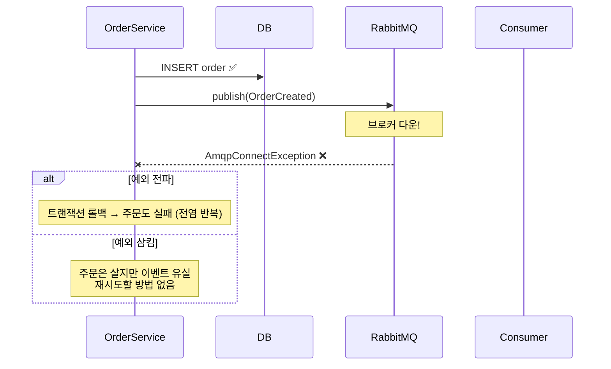

# #0-4. 이벤트의 탄생

## 흐름도



## 스토리

화요일 오전 10시. #0-1, #0-2, #0-3을 겪은 팀이 결단을 내렸다.

> "주문 저장과 후속 처리를 분리하자. 메시지 큐를 도입하자."

RabbitMQ를 도입했다. 코드가 깔끔해졌다.

```java
@Transactional
public Order createOrder(String itemName, int quantity, int totalPrice) {
    Order order = orderRepository.save(new Order(itemName, quantity, totalPrice));
    rabbitTemplate.convertAndSend("order.exchange", "order.created",
            new OrderCreatedEvent(order.getId()));
    return order;
}
```

주문 API 응답 시간이 400ms → 15ms로 줄었다. DB INSERT + MQ publish만 하면 끝이었다. 알림이 느려도 결제가 느려도 주문 API는 영향 없었다.

3주간 완벽하게 동작했다. 팀은 만족했다.

4주차 목요일 새벽 3시. RabbitMQ 클러스터 롤링 업그레이드가 진행됐다. 5분간 브로커 연결이 끊겼다.

새벽 3시 01분. 주문이 들어왔다. `orderRepository.save()` 성공. `rabbitTemplate.convertAndSend()` — `AmqpConnectException`.

`convertAndSend()`가 `@Transactional` 안에 있었다. 예외가 전파되면 트랜잭션이 롤백된다. 주문 자체가 실패하는 것이다. #0-1(전염)과 같은 문제가 MQ를 도입했는데도 반복됐다.

"그러면 예외를 잡자."

```java
@Transactional
public Order createOrderSwallowingException(String itemName, int quantity, int totalPrice) {
    Order order = orderRepository.save(new Order(itemName, quantity, totalPrice));
    try {
        rabbitTemplate.convertAndSend("order.exchange", "order.created",
                new OrderCreatedEvent(order.getId()));
    } catch (AmqpException e) {
        log.error("이벤트 발행 실패: {}", order.getId(), e);
    }
    return order;
}
```

주문은 살았다. 하지만 이벤트는 사라졌다. 재고 차감도 안 됐고, 알림도 안 갔다.

**5분간 들어온 주문 23건의 이벤트가 유실됐다.** 발행에 실패했다는 사실이 어디에도 기록되지 않았으므로, 재시도할 방법도 없었다. 로그를 뒤져서 하나하나 수동으로 복구해야 했다.

## 교훈

- MQ를 도입해도 "DB 커밋 + MQ 발행"이 원자적이지 않으면 불일치가 발생한다.
- 예외를 전파하면: 브로커 장애가 비즈니스 장애로 전염 (동기 호출과 같은 문제)
- 예외를 삼키면: 이벤트가 유실되고, 유실됐다는 사실조차 기록되지 않음
- 필요한 것: "이벤트를 발행해야 한다"는 사실을 DB에 기록하는 것. 발행 자체가 실패해도, 기록이 남아있으면 나중에 재시도할 수 있다. 이것이 Outbox 패턴의 출발점이다.

## 더 생각해보기

- 예외를 전파하면 비즈니스가 죽고, 삼키면 이벤트가 유실된다. 이 딜레마에서 "둘 다 아닌" 선택지가 있을까?
- MQ 발행을 @Transactional 밖으로 빼면 어떻게 될까? 트랜잭션 커밋 후에 발행하면 유령 이벤트 문제는 없지만, 그게 #0-5에서 다루는 문제와 어떻게 연결될까?
- "이벤트를 발행해야 한다는 사실을 기록한다"는 아이디어가 Outbox 말고 다른 형태로 구현될 수도 있을까? (힌트: 애플리케이션 레벨 WAL, 로컬 파일 큐)

## 재현

```bash
./gradlew test --tests "S00_4_EventBirthTest"
```
