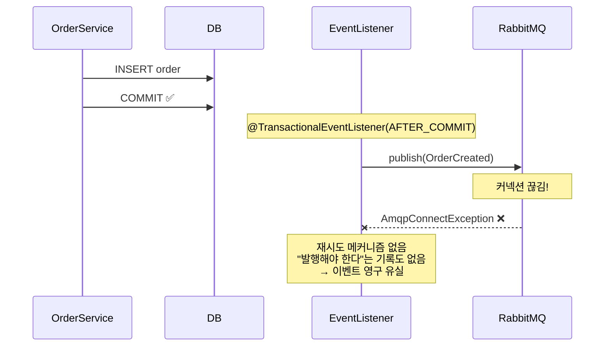

# #0-5. DB 커밋은 됐는데

## 흐름도



## 스토리

수요일 오후 4시. #0-4의 교훈을 받아, 이번에는 다른 접근을 시도했다.

"이벤트 발행을 트랜잭션 커밋 후에 하면 어떨까?"

```java
// AfterCommitOrderService — 주문 저장 + Spring 이벤트 발행
@Transactional
public Order createOrder(String itemName, int quantity, int totalPrice) {
    Order order = orderRepository.save(new Order(itemName, quantity, totalPrice));
    eventPublisher.publishEvent(new OrderCreatedEvent(order.getId()));
    return order;
}

// OrderEventListener — 커밋 후 MQ 발행
@TransactionalEventListener(phase = TransactionPhase.AFTER_COMMIT)
public void handleOrderCreated(OrderCreatedEvent event) {
    rabbitTemplate.convertAndSend("order.exchange", "order.created", event);
}
```

`@TransactionalEventListener(phase = AFTER_COMMIT)`. DB 트랜잭션이 커밋된 후에 이벤트를 발행한다. 이러면 DB 커밋 실패 시 발행도 안 되니까 유령 이벤트 문제는 없다. 똑똑한 설계처럼 보였다.

수요일 오후 4시 15분. 주문이 들어왔다. DB 커밋 성공. `AFTER_COMMIT` 리스너가 실행됐다. `convertAndSend()` 호출. 그런데 바로 이 순간 RabbitMQ 커넥션이 끊겼다. `AmqpConnectException`.

DB에는 주문이 저장돼있다. 하지만 이벤트는 발행되지 않았다. 그리고 **다시 시도할 방법이 없다.** 트랜잭션은 이미 커밋됐고, 리스너는 한 번만 실행되고, 실패한 이벤트를 기억하는 곳이 어디에도 없다.

`@TransactionalEventListener`는 "커밋 후에 한 번 시도"할 뿐이다. 실패 시 재시도 메커니즘이 없다. retry를 붙여도, 브로커가 5분간 죽어있으면 그 사이의 이벤트는 전부 유실된다.

결국 문제는 똑같았다. **"이벤트를 발행해야 한다"는 사실이 영속화되지 않는 한, 어떤 시점에서든 유실 가능성이 존재한다.**

DB에 주문을 저장할 때, **같은 트랜잭션 안에서** "이 이벤트를 발행해야 한다"는 기록도 함께 저장하면? 그러면 발행이 실패해도, DB에 기록이 남아있으니 나중에 재시도할 수 있다.

이것이 **Outbox 테이블**이다.

## 교훈

- @TransactionalEventListener(AFTER_COMMIT)은 "커밋 후 1회 시도"일 뿐, 발행을 보장하지 않는다.
- 핵심 원칙: "이벤트를 발행해야 한다"는 의도를 DB에 영속화해야 한다.
- 비즈니스 데이터와 이벤트 기록을 같은 트랜잭션에 넣으면: 둘 다 커밋되거나, 둘 다 롤백된다 (원자성). 발행 실패 시 DB에 기록이 남아있으므로 재시도 가능.
- 이것이 Outbox 패턴의 핵심 아이디어다.

## 더 생각해보기

- @TransactionalEventListener(AFTER_COMMIT)에 Spring Retry를 조합하면 해결되지 않을까? retry 중에 앱이 재시작되면 어떻게 될까?
- Outbox 패턴은 "DB에 기록"하는 방식이다. 만약 DB가 아니라 로컬 파일에 기록하면? 어떤 장단점이 있을까? 왜 보통 DB를 선택할까?
- Outbox 테이블 없이, 비즈니스 테이블의 상태 컬럼으로 같은 효과를 낼 수 있을까? 예: orders 테이블에 event_published 컬럼을 추가하는 방식. Outbox 테이블을 별도로 두는 것과 뭐가 다를까?

## 재현

```bash
./gradlew test --tests "S00_5_AfterCommitTest"
```
