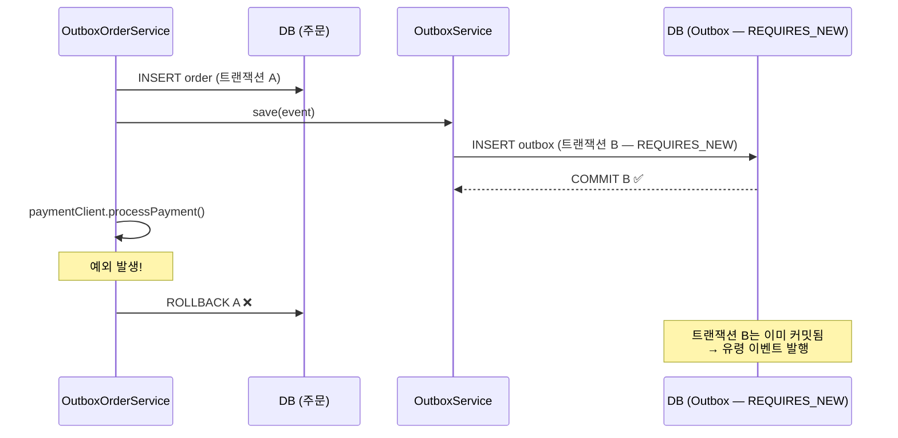

# #1. 유령 이벤트

## 흐름도



## 스토리

화요일 오전 10시 15분. 신규 기능 배포 후 첫 주문이 들어왔다.

주문 서비스에 새로 합류한 개발자가 Outbox 저장 로직을 분리하면서 깔끔한 설계를 고민했다. "Outbox 저장은 별도 서비스로 분리하는 게 책임 분리에 맞지 않을까?" 그래서 `OutboxService.save()`에 `@Transactional(propagation = REQUIRES_NEW)`를 달았다.

```java
// OutboxOrderService — 주문 저장 + Outbox 저장 + 결제 호출
@Transactional
public Order createOrder(String itemName, int quantity, int totalPrice) {
    Order order = orderRepository.save(new Order(itemName, quantity, totalPrice));

    outboxService.save(new OutboxEvent(
            "Order", order.getId(), "OrderCreated",
            "{\"orderId\":" + order.getId() + "}"
    ));

    paymentClient.processPayment(order.getId());
    return order;
}

// OutboxService — REQUIRES_NEW로 별도 트랜잭션
@Transactional(propagation = Propagation.REQUIRES_NEW)
public void save(OutboxEvent event) {
    outboxRepository.save(event);
}
```

금요일 프로모션으로 결제 서버에 트래픽이 몰렸다. `paymentClient.processPayment()`가 타임아웃을 뱉었다. `createOrder()`의 트랜잭션이 롤백됐다. 주문은 DB에 저장되지 않았다.

그런데 `outboxService.save()`는 `REQUIRES_NEW`였다. 별도 트랜잭션이라 이미 커밋된 뒤였다. Outbox 테이블에는 "주문 생성됨"이라는 row가 멀쩡히 남아있었다.

폴러가 이 row를 집어들었다. RabbitMQ에 메시지가 발행됐다. 컨슈머가 받아서 재고를 차감했다. 알림 서비스가 고객에게 "주문이 완료되었습니다"를 보냈다.

고객이 주문 내역을 확인했다. 비어있었다.

> "주문 완료 알림이 왔는데, 주문 내역에는 아무것도 없어요."

존재하지 않는 주문의 알림. 차감됐지만 근거가 없는 재고. 유령이 시스템을 돌아다니고 있었다.

## 교훈

- 비즈니스 로직과 Outbox INSERT는 반드시 같은 트랜잭션에 있어야 한다.
- REQUIRES_NEW로 분리하는 순간, "비즈니스 롤백 + 이벤트 커밋"이라는 불일치가 가능해진다.
- 반대로 "비즈니스 커밋 + 이벤트 롤백"도 가능하다. 이 경우 이벤트가 영원히 발행되지 않는다.
- 깔끔한 설계보다 정합성이 우선이다.

## 더 생각해보기

- "같은 트랜잭션에 넣어야 한다"는 원칙은 명확하다. 그런데 Outbox 저장 로직을 재사용 가능한 별도 모듈로 분리하고 싶다면? 트랜잭션을 분리하지 않으면서 코드를 분리하는 방법이 있을까?
- 유령 이벤트가 발행됐을 때, 컨슈머가 이를 감지할 수 있을까? "주문을 처리하려는데 주문이 없다"는 상황을 에러로 처리해야 할까, 무시해야 할까, 잠시 기다려야 할까?
- 이벤트 소싱(Event Sourcing)에서는 이 문제가 어떻게 해결될까?

## 재현

```bash
./gradlew test --tests "S01_PhantomEventTest"
```
