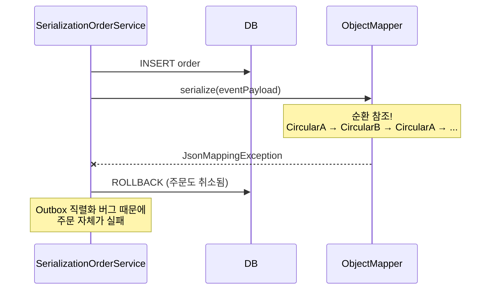

# #2. 직렬화가 비즈니스를 죽이다

## 흐름도



## 스토리

수요일 오후 2시. 평화로운 오후.

신규 API가 배포됐다. 주문 생성 시 고객 정보를 함께 Outbox에 저장하도록 변경된 것이다. 코드 리뷰에서도 특이 사항 없이 승인됐다.

```java
// SerializationOrderService — 주문 저장 + 직렬화 + Outbox 저장
@Transactional
public Order createOrder(String itemName, int quantity, int totalPrice, Object eventPayload) {
    Order order = orderRepository.save(new Order(itemName, quantity, totalPrice));

    try {
        String payload = objectMapper.writeValueAsString(eventPayload);
        outboxRepository.save(new OutboxEvent("Order", order.getId(), "OrderCreated", payload));
    } catch (JsonProcessingException e) {
        throw new RuntimeException("Outbox 직렬화 실패", e);
    }

    return order;
}
```

이벤트 payload에 JPA 엔티티를 직접 넣었다. 엔티티 안에 양방향 연관관계가 있었다. `objectMapper.writeValueAsString()`이 순환 참조를 만나 `JsonMappingException`을 뱉었다.

예외가 터졌다. `@Transactional` 안이었으므로 전체가 롤백됐다. 주문도, Outbox도, 전부.

고객 화면에는 "주문에 실패했습니다"가 떴다. 결제는 되지 않았으니 금전적 피해는 없었지만, **Outbox 직렬화 버그 때문에 주문 자체가 불가능해진 것**이다.

Outbox는 메시지의 안전한 전달을 위해 도입한 것인데, 오히려 비즈니스의 가용성을 낮추는 역할을 한 셈이다.

## 교훈

- Outbox payload 직렬화는 비즈니스 트랜잭션 안에서 일어난다. 직렬화가 실패하면 비즈니스도 같이 죽는다.
- 엔티티를 직접 직렬화하지 말 것. 반드시 직렬화 전용 DTO로 변환한 뒤 직렬화해야 한다.
- 순환 참조, Lazy proxy, 직렬화 불가능한 필드를 사전에 테스트로 검증해야 한다.
- Outbox가 비즈니스의 단일 장애 지점(SPOF)이 될 수 있다는 사실을 잊지 말 것.

## 더 생각해보기

- 직렬화 실패가 비즈니스를 죽이는 게 정말 나쁜 걸까? "잘못된 이벤트가 발행되는 것"과 "주문이 실패하는 것" 중 어떤 게 더 위험할까?
- 직렬화를 트랜잭션 밖에서 하면 이 문제를 피할 수 있을까? 그러면 어떤 새로운 문제가 생길까?
- JSON 직렬화 말고 다른 직렬화 방식(Protobuf, Avro)을 쓰면 이 문제가 줄어들까, 아니면 다른 형태로 바뀔 뿐일까?

## 재현

```bash
./gradlew test --tests "S02_SerializationKillsTest"
```
