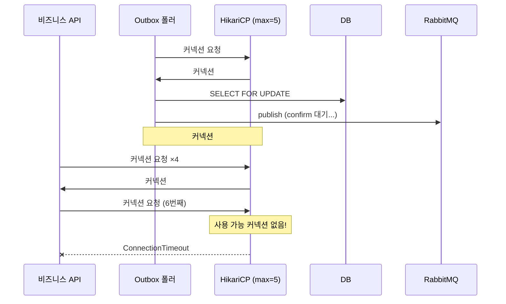

# #3. 커넥션 쟁탈전

## 흐름도



## 스토리

목요일 오후 6시. 퇴근 시간대 트래픽이 올라가는 중.

시스템 구성은 단순했다. Spring Boot 앱 하나에 HikariCP max-pool-size 5. 비즈니스 API와 Outbox 폴러가 같은 커넥션 풀을 공유하고 있었다.

```java
// OutboxPoller — SELECT FOR UPDATE → 발행 → confirm 대기 → UPDATE를 하나의 트랜잭션으로 수행
@Transactional
public void pollAndPublish(long publishDelayMillis) {
    List<OutboxEvent> events = entityManager
            .createQuery("SELECT e FROM OutboxEvent e WHERE e.status = 'INIT'", OutboxEvent.class)
            .setLockMode(LockModeType.PESSIMISTIC_WRITE)
            .getResultList();

    for (OutboxEvent event : events) {
        // 브로커 발행 + Publisher Confirm 대기
        // 이 동안 DB 커넥션을 계속 점유한다
        Thread.sleep(publishDelayMillis);
        event.markAsSent();
    }
}
```

폴러는 1초 간격으로 돌고 있었다. `SELECT FOR UPDATE` → 메시지 발행 → Publisher Confirm 대기 → `UPDATE status='SENT'`. 이 전체 과정이 하나의 트랜잭션이었고, confirm 대기가 평소 100ms 정도라 별 문제 없었다.

그런데 오늘은 RabbitMQ가 느렸다. confirm 응답이 2초, 3초씩 걸리기 시작했다. 폴러 트랜잭션이 커넥션을 3초간 물고 있었다.

동시에 API 요청이 몰리고 있었다. 커넥션 풀에 여유가 없었다. HikariCP 로그:

```
HikariPool-1 - Connection is not available, request timed out after 2000ms
(total=5, active=5, idle=0, waiting=1)
```

API 서버가 502를 뱉기 시작했다. 폴러가 커넥션을 오래 잡고 있어서 비즈니스 요청이 커넥션을 못 얻는 것이었다.

아이러니하게도, Outbox 폴러는 정상적으로 동작하고 있었다. 메시지도 잘 발행되고 있었다. 메시지 전달을 보장하려고 도입한 Outbox가, 정작 메시지를 만들어내는 비즈니스 API를 죽이고 있었다.

## 교훈

- 폴러와 비즈니스 API가 같은 커넥션 풀을 쓰면, 폴러의 지연이 비즈니스에 전파된다.
- 폴러용 DataSource를 분리하거나, 폴러 트랜잭션의 타임아웃을 짧게 잡아야 한다.
- "SELECT FOR UPDATE → 발행 → confirm 대기 → UPDATE"를 하나의 트랜잭션으로 묶으면 커넥션 점유 시간이 길어진다. 발행과 DB 업데이트를 분리하는 설계를 고려할 것.

## 더 생각해보기

- 폴러 전용 DataSource를 분리하면 커넥션 총 수가 늘어난다. DB 입장에서 max_connections 제한이 있다면, 풀을 나누는 게 항상 좋은 선택일까?
- 폴러 트랜잭션에서 "SELECT FOR UPDATE → 발행 → confirm 대기 → UPDATE"를 하나로 묶지 않고 쪼개면 커넥션 점유가 줄어든다. 하지만 쪼개면 어떤 새로운 문제가 생길까? (힌트: SELECT FOR UPDATE의 락은 트랜잭션이 끝나면 풀린다)
- 커넥션 풀 고갈을 사전에 감지하려면 어떤 메트릭을 모니터링해야 할까?

## 재현

```bash
./gradlew test --tests "S03_ConnectionWarTest"
```
