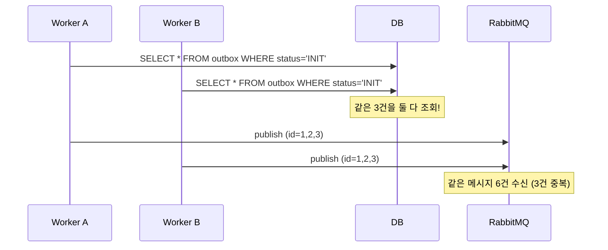

# #4. 이중 배달

## 흐름도



## 스토리

월요일 오전 9시. 스케일아웃을 마친 직후.

트래픽 증가에 대비해 인스턴스를 2대로 늘렸다. 두 인스턴스 모두 같은 코드를 실행하고, 같은 DB를 보고, 같은 `@Scheduled` 폴러가 돌고 있었다.

```java
// SimpleOutboxPoller — 락 없이 단순 조회하는 폴러
@Transactional
public List<Long> pollAndPublish(long delayAfterQueryMillis) {
    List<OutboxEvent> events = outboxRepository.findByStatus("INIT");

    // 조회와 발행 사이의 간격 — 이 동안 다른 워커가 같은 row를 조회할 수 있다
    Thread.sleep(delayAfterQueryMillis);

    List<Long> publishedIds = new ArrayList<>();
    for (OutboxEvent event : events) {
        publishedIds.add(event.getId());
        event.markAsSent();
    }

    return publishedIds;
}
```

9시 00분 01초. 인스턴스 A의 폴러가 실행됐다. `SELECT * FROM outbox WHERE status = 'INIT'`. 3건이 조회됐다.

9시 00분 01초. 거의 동시에, 인스턴스 B의 폴러도 실행됐다. 같은 쿼리. 같은 3건이 조회됐다. A가 아직 status를 SENT로 바꾸기 전이었으니까.

A가 3건을 RabbitMQ에 발행했다. B도 같은 3건을 발행했다. 컨슈머는 같은 메시지를 6건 수신했다. 주문 확인 알림이 고객에게 2통씩 갔다.

> "주문 알림이 두 번 왔는데, 혹시 두 번 결제된 건 아니죠?"

단일 인스턴스에서는 한 번도 발생하지 않았던 문제였다. 스케일아웃하는 순간 터진 것이다.

## 교훈

- SELECT ... FOR UPDATE SKIP LOCKED 없이 멀티 인스턴스를 운영하면 중복 발행은 필연이다.
- 단일 인스턴스에서 "잘 되니까"는 멀티 인스턴스의 증거가 아니다.
- SKIP LOCKED는 이미 잠긴 row를 건너뛰므로, A가 잡은 row를 B가 다시 잡지 않는다.

## 더 생각해보기

- SKIP LOCKED 대신 "리더 선출(leader election)"로 한 인스턴스만 폴링하게 하면 어떨까? SKIP LOCKED 방식과 비교해서 장단점이 뭘까?
- ShedLock 같은 분산 락 라이브러리를 쓰는 것과 SKIP LOCKED를 쓰는 것의 차이는?
- 멀티 인스턴스에서 중복 발행이 발생해도 컨슈머 멱등성만 보장되면 괜찮지 않을까? 그러면 SKIP LOCKED가 굳이 필요할까?

## 재현

```bash
./gradlew test --tests "S04_DoubleDeliveryTest"
```
