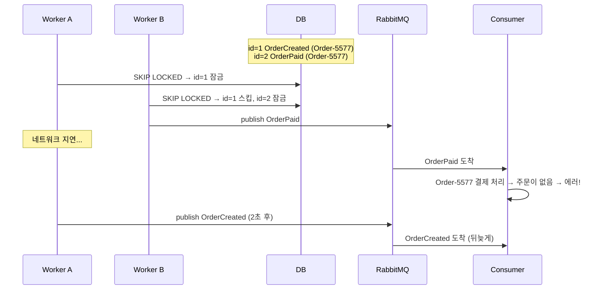

# #5. 역전된 시간

## 흐름도



## 스토리

화요일 오후 3시. 주문 시스템이 정상 운영 중.

고객이 주문을 넣었다. 시스템에서는 두 개의 이벤트가 순서대로 Outbox에 INSERT됐다.

```
[id=1, aggregate=Order-5577, type=OrderCreated, status=INIT]
[id=2, aggregate=Order-5577, type=OrderPaid,    status=INIT]
```

id 1이 먼저, 2가 다음. 당연히 "생성 → 결제" 순서로 발행되어야 한다.

폴러는 2대의 인스턴스에서 `SELECT FOR UPDATE SKIP LOCKED`로 돌고 있었다.

```java
// SkipLockedOutboxPoller — SKIP LOCKED로 하나씩 처리
@Transactional
public String pollOneAndPublish(long publishDelayMillis) {
    List<OutboxEvent> events = outboxRepository.findInitEventsForUpdateSkipLocked();
    // SELECT * FROM outbox_events WHERE status = 'INIT'
    // ORDER BY id LIMIT 1 FOR UPDATE SKIP LOCKED

    if (events.isEmpty()) return null;

    OutboxEvent event = events.get(0);
    Thread.sleep(publishDelayMillis); // 브로커 발행 시뮬레이션
    event.markAsSent();
    return event.getEventType();
}
```

Worker A가 id=1(OrderCreated)을 잠갔다. 거의 동시에 Worker B가 SKIP LOCKED로 id=1을 건너뛰고 id=2(OrderPaid)를 잠갔다.

Worker B는 네트워크 상태가 좋았다. id=2(OrderPaid)를 즉시 발행했다.

Worker A는 운이 나빴다. RabbitMQ와의 커넥션이 일시적으로 느려져서 id=1(OrderCreated)의 발행이 2초 지연됐다.

결제 완료 이벤트가 먼저 도착했는데, 주문이 아직 없었다. SKIP LOCKED는 중복을 막아줬지만, **순서는 막아주지 못했다**.

## 교훈

- SKIP LOCKED는 중복 방지 도구이지, 순서 보장 도구가 아니다.
- 같은 aggregate의 이벤트가 다른 워커에 분배되면 순서가 역전될 수 있다.
- 해결 방법:
  1. 같은 aggregate_id의 이벤트는 같은 워커가 처리하도록 파티셔닝
  2. 컨슈머에서 sequence_number를 체크하고, 이전 시퀀스가 없으면 NACK 후 재시도
  3. 상태 머신 기반으로 유효하지 않은 전이를 거부

## 더 생각해보기

- 순서 보장을 위해 같은 aggregate의 이벤트를 같은 워커가 처리하면, 특정 워커에 부하가 몰리는 hot partition 문제가 생길 수 있다. 순서 보장과 부하 분산 사이의 트레이드오프를 어떻게 잡을까?
- 모든 이벤트에 순서 보장이 필요할까? "주문 생성 → 결제 완료"는 순서가 중요하지만, "재고 차감"과 "알림 발송"은 순서가 상관없을 수 있다. 이벤트 종류별로 전략을 다르게 가져가는 건 어떨까?
- RabbitMQ 대신 Kafka를 쓰면 파티션 키 기반으로 순서 보장이 기본 제공된다. 그러면 Kafka가 항상 더 나은 선택일까?

## 재현

```bash
./gradlew test --tests "S05_TimeReversalTest"
```
